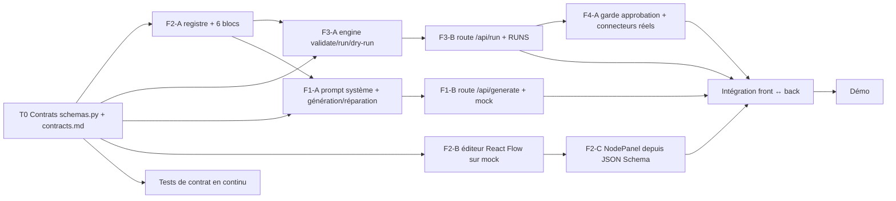

# Plan multi-agents et tâches

## 1. Capacités vérifiées de l'environnement
- Sous-agents disponibles (outil Agent) ; Git disponible (une branche par tâche possible) ; Python + pytest vérifiés ; Node/npm présents dans le dépôt (non exécuté dans cette session).
- Limite : **≤ 10 agents actifs**. Pour un projet de cette taille, **6 suffisent** ; les rôles 2/3/4/5 ont été fusionnés.

## 2. Agents actifs
| # | Rôle | Possède (fichiers) |
|---|---|---|
| A1 | Orchestrateur + architecte + analyste + UML + données (rôles 1–5 fusionnés) | `docs/**`, `backend/app/schemas.py` (contrat) |
| A6a | Backend moteur & API | `backend/app/engine.py`, `backend/app/main.py` |
| A6b | Backend blocs & connecteurs | `backend/app/nodes/**`, `backend/app/connectors/**` |
| A7 | Frontend | `frontend/**` |
| A8 | IA | `backend/app/ai/**`, `experiments/**` |
| A9+A10 | Tests, intégration, démo | `backend/tests/**`, `README.md`, `docs/TESTING.md` |

## 3. Graphe de tâches

Chemin critique : T0 → F2-A → F3-A → F3-B → INT → DEMO. Parallèles dès T0 : F2-B (front sur mock), F1-A (IA), tests.

## 4. Tâches
| ID | Fonct. | Objectif | Agent | Dépend | Fichiers autorisés | Contrat | Critères d'acceptation / tests | Statut |
|---|---|---|---|---|---|---|---|---|
| T0 | toutes | Figer schémas et routes | A1 | — | schemas.py, docs/contracts.md | contracts.md | Revue par A6/A7/A9 | ✅ Fait |
| F2-A | F2/F3 | Registre + 6 blocs | A6b | T0 | nodes/** | NodeSpec | `/api/nodes` liste 6 types | ✅ Vérifié (test API) |
| F3-A | F3 | Validation, tri topo, gabarits, dry-run | A6a | F2-A | engine.py | validate/run | test_cycle, test_missing_param, test_condition_branches, test_dry_run | ✅ Vérifié |
| F3-B | F3 | `POST /api/run`, `GET /api/runs/{id}` | A6a | F3-A | main.py | RunRequest/RunResult | appel API | ✅ Vérifié |
| F4-A | F4 | Garde `approved` + Telegram/Gmail | A6a/A6b | F3-B | main.py, connectors/** | §Règles | test_api_nodes_and_approval_gate ; envoi réel **non testé** (identifiants) | 🟡 Partiel |
| F1-A | F1 | Prompt + boucle de réparation | A8 | F2-A | ai/generator.py | generate() | test_generator_repairs / gives_up | ✅ Vérifié |
| F1-B | F1 | `/api/generate`, 503, mock | A8 | F1-A | ai/llm.py, main.py (coord. A6a) | GenerateResponse | test_generate_503 / mock_mode | ✅ Vérifié |
| F1-C | F1 | Gemma 4 réel | A8 | F1-B | — | — | génération réelle sur 5 prompts | ⬜ Non exécuté |
| F2-B | F2 | Éditeur graphe + conversion + dagre | A7 | T0 | frontend/src/** | Workflow | aller-retour sans perte | 🟡 Codé, non vérifié ici |
| F2-C | F2 | Formulaire de paramètres depuis JSON Schema | A7 | F2-B | NodePanel.jsx | NodeCatalogEntry | édition reflétée dans le JSON | 🟡 Codé, non vérifié ici |
| F3-C | F3/F4 | Journal + confirmation exécution | A7 | F2-B | RunLog.jsx | RunResult | affichage des statuts | 🟡 Codé, non vérifié ici |
| INT | toutes | Parcours de bout en bout | A9+A10 | tout | README.md | — | prompt → simulation en mode mock dans le navigateur | ⬜ À faire |
| EXP | F1 | Harnais d'évaluation | A8 | F1-C | experiments/** | — | métriques §TESTING | ⬜ Facultatif |

## 5. Règles de conflit
Un propriétaire par fichier ; `main.py` est partagé A6a/A8 → A8 propose, A6a fusionne. `schemas.py` ne change que via A1 avec annonce. Une branche par tâche, petites PR, `pytest` vert avant fusion.

## 6. Planning 4 h
| Créneau | Activité |
|---|---|
| 00:00–00:20 | Cadrage, requirements, use cases |
| 00:20–00:40 | Architecture, schemas.py, contrats, tâches |
| 00:40–02:30 | F2-A/F3-A/F1-A en parallèle ; F2-B sur mock ; tests continus |
| 02:30–03:20 | Intégration, remplacement des mocks |
| 03:20–03:45 | Stabilisation, données de démo |
| 03:45–04:00 | Démo |

## 7. Prochaines actions (priorité)
1. INT : lancer back (`KERNEL_LLM_MOCK=1`) + front, dérouler le parcours principal, consigner dans TESTING.md.
2. F1-C : brancher Gemma 4 et tester 5 prompts de démo.
3. F4-A : un envoi Telegram réel avec un bot de test.
4. (Facultatif) persistance SQLite, harnais `experiments/`.
