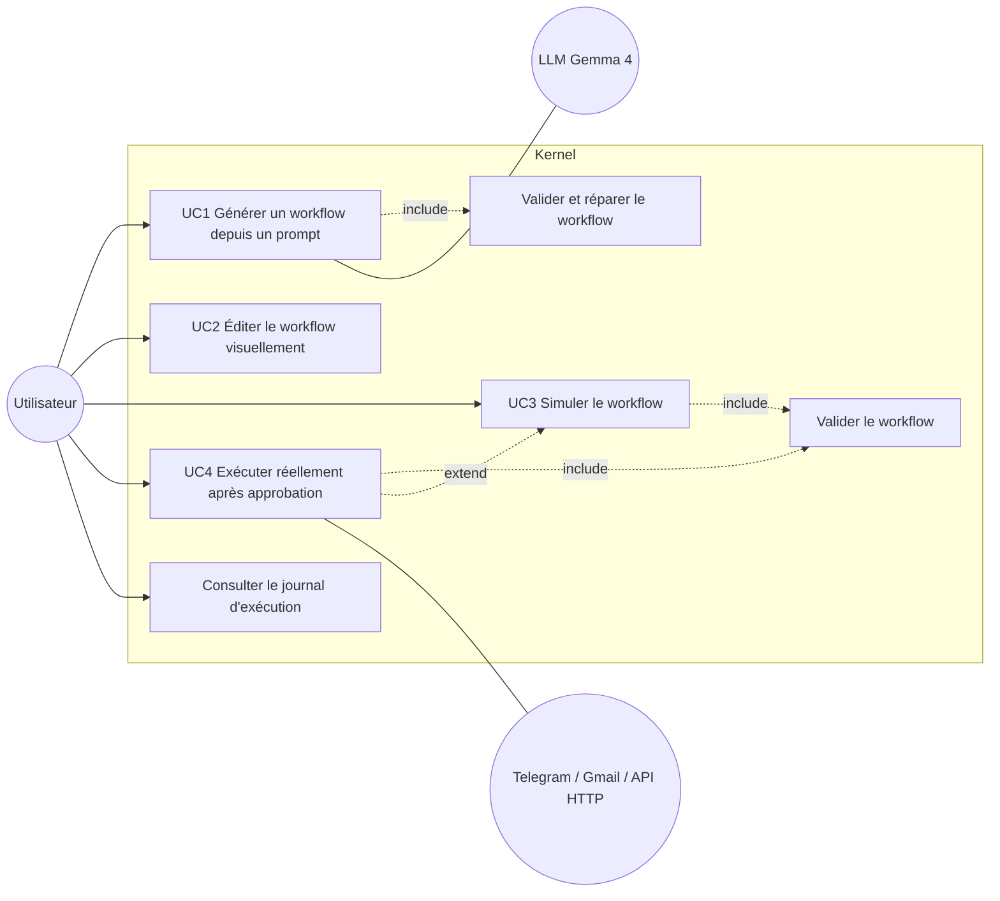

# Cas d'utilisation

## UC1 — Générer un workflow
- **Acteur** : Utilisateur (secondaire : LLM)
- **Préconditions** : backend démarré ; LLM configuré **ou** `KERNEL_LLM_MOCK=1`.
- **Nominal** : 1) l'utilisateur saisit un prompt ; 2) `POST /api/generate` ; 3) le générateur construit le prompt système depuis le catalogue de blocs ; 4) le LLM renvoie du JSON ; 5) validation OK ; 6) le graphe s'affiche (disposition dagre).
- **Alternatifs** : 5a) invalide → les erreurs sont renvoyées au LLM, nouvelle tentative (max `MAX_REPAIRS`=2).
- **Erreurs** : prompt vide → 400 ; LLM non configuré/injoignable → 503 ; échec après réparations → 200 avec `workflow: null` et `errors`.
- **Résultat** : workflow valide affiché dans l'éditeur.
- **Critères d'acceptation** : un JSON invalide puis valide produit `attempts=2` ; trois invalides → `workflow=null`, `attempts=3`.

## UC2 — Éditer le workflow
- **Acteur** : Utilisateur — **Préconditions** : catalogue chargé (`GET /api/nodes`).
- **Nominal** : sélectionner un bloc, modifier ses paramètres via un formulaire généré depuis son JSON Schema ; ajouter/supprimer blocs et liens ; choisir la branche true/false d'un lien issu d'une condition.
- **Erreurs** : paramètre requis vide, branche manquante → signalées à la simulation (validation serveur).
- **Critères** : l'aller-retour schéma Kernel → React Flow → schéma Kernel préserve nœuds, liens et branches.

## UC3 — Simuler
- **Acteur** : Utilisateur — **Préconditions** : workflow présent.
- **Nominal** : `POST /api/run` avec `dry_run: true` ; validation ; tri topologique ; exécution des blocs purs (trigger, condition) ; blocs à effet de bord marqués `simulated: true` ; journal affiché.
- **Alternatifs** : branche non prise → étapes `skipped`.
- **Erreurs** : workflow invalide → `status: error` + `validation_errors`, aucune étape exécutée.
- **Critères** : aucun appel réseau en dry-run (test `test_dry_run_simulates_side_effects`).

## UC4 — Exécuter réellement
- **Acteur** : Utilisateur (secondaires : Telegram, Gmail, API HTTP)
- **Préconditions** : simulation conseillée ; identifiants `KERNEL_*` présents pour les connecteurs utilisés.
- **Nominal** : l'utilisateur clique « Exécuter » ; l'UI demande confirmation ; `POST /api/run` avec `dry_run: false, approved: true` ; exécution réelle ; journal.
- **Erreurs** : `approved` absent → 400 ; erreur d'un connecteur → étape `error`, run `error`, étapes suivantes non exécutées.
- **Critères** : la requête sans approbation est refusée (test API).

## UC5 — Consulter le journal
`GET /api/runs/{run_id}` ; 404 si inconnu. Stockage **en mémoire** (perdu au redémarrage — limite assumée).
